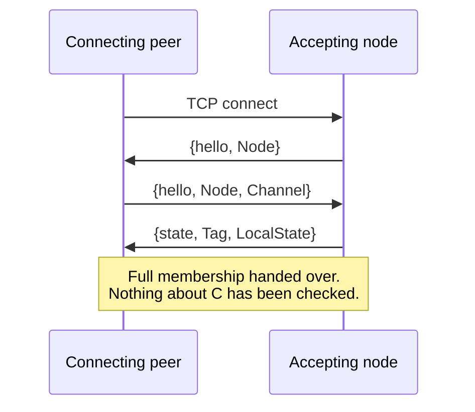
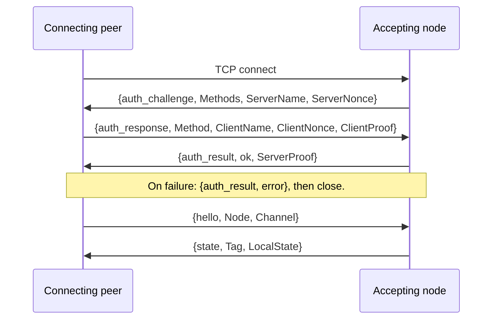

# ADR-000005: Peer Authentication — A Pluggable, Negotiated Challenge/Response Handshake

- **Status:** ACCEPTED
- **Decision:** Insert an authentication phase into the peer handshake, ahead of
  today's `hello`/`state` exchange, so that no membership or application data
  reaches a peer that has not proven its identity. The check is delegated to a
  pluggable `partisan_peer_authentication` behaviour with three verifiers —
  **cryptosign** (per-node Ed25519 keypairs), **gossip keyring** (a rotation-capable
  shared-key ring), and **HMAC-secret** (a single static shared value) — and each
  node negotiates the strongest method both sides accept from a configured,
  ordered method list. An empty list, the default, turns the phase off and
  reproduces today's behaviour exactly, so the feature is additive.

## Context

The peer handshake has no identity check today. On accept, the server sends
`{hello, Node}` and, on receiving the client's reply, immediately builds the
local peer-service state and sends it back — full cluster membership — before
anything about the connecting peer has been verified:

`Tag` is a topology-role label, not a secret, and there is no cookie or HMAC
anywhere in this exchange — Partisan does not use Erlang distribution's cookie by
default (`connect_disterl = false`), so that mechanism is not in play either. The
peer plane's entire security posture today rests on **network isolation**
(documented in `cluster_security.md`) plus **optional TLS**, which authenticates
the *channel* but not the *peer's identity* unless an operator has fully configured
`verify_peer` with a private CA on both sides — a step nothing enforces or checks.
This gap predates the current major version; it is not a regression, and closing
the cheap, non-breaking half of it (bounding frame size, bounding TLS handshake
time, warning loudly at startup) was handled separately. What remains is
structural: an unauthenticated TCP connection can still reach the membership
merge and the peer-message decoder.

Closing that requires changing the handshake contract itself, which is why it is
treated as its own design record rather than folded into the non-breaking pass.

## The decision

### 1. An authentication phase ahead of `hello`/`state`

A new leading exchange runs before the existing handshake on both the accepting
and the connecting side. Only once it succeeds does either side proceed to
`hello`/`state` as today; on failure, the connection is closed and no membership
or user data is ever sent.

Authentication is **mutual**: each side challenges the other, since either role
can be the one an operator wants to keep an impostor from impersonating. The
three frames carry both exchanges. The server's nonce is its challenge to the
client, and the client's nonce is its challenge to the server.

A proof covers the role of the prover, the chosen method, the offered method
list, both names, both nonces and the channel binding of the connection. A
proof is therefore not valid in the other direction, in another exchange, after
a change to the offered list, or on another transport session.

The channel binding of a TLS 1.3 connection is the exporter value of the
session (RFC 9266, `tls-exporter`). A connection over TCP, or over an earlier
TLS version, has none. Each end takes the binding and its type from its own
socket. No frame carries either.

Each end states in its frame whether its configuration allows TLS 1.3, and
the proofs cover both statements. When both ends allow TLS 1.3 and the
session has no binding, the phase fails.

A peer that authenticates under a name presents the same name in `hello`. The
accepting node closes the connection when the names differ.

A node closes a connection whose phase does not complete within
`peer_auth_timeout`.

### 2. A pluggable behaviour, not a hardcoded check

`partisan_peer_authentication` is a small, I/O-free behaviour — `init/1`,
`respond/2`, `verify/4` — in the same spirit as
`partisan_broadcast_engine` (ADR-000002): the callbacks compute, they do not
send. A negotiator module, `partisan_peer_auth`, drives the exchange from both
`partisan_peer_service_server` and `partisan_peer_service_client`, so the
protocol logic exists once, not twice. The negotiator makes the nonces and
builds the bytes a proof covers: a verifier signs and checks opaque bytes.

### 3. Three verifiers behind the same seam

| Method | Primitive | Identity granularity | Rotation |
|---|---|---|---|
| `cryptosign` | Ed25519 sign/verify | per-node (the public key *is* the identity) | replace one node's key; no cluster-wide step |
| `gossip_keyring` | HMAC-SHA256 over an ordered list of active keys | cluster-wide (proves membership, not which node) | add a key, wait out an overlap window, retire the old one |
| `hmac_secret` | HMAC-SHA256 over one static value | cluster-wide | none — changing it is a coordinated, cluster-wide config change |

`hmac_secret` is implemented as a keyring of size one, not a second MAC
implementation: the two symmetric methods share one verifier module, and only
the *method name* (and therefore what a deployment tells its neighbours it will
accept) differs. `cryptosign` is a separate, asymmetric verifier.

### 4. Negotiation, not a single fixed method

Each node configures an ordered list of acceptable methods,
`peer_auth_methods :: [cryptosign | gossip_keyring | hmac_secret | anonymous]`,
strongest preference first — the same shape as WAMP's `authmethod` negotiation.
`anonymous` is no authentication. The accepting node offers its list; the
connecting node picks the first offered entry that it also accepts.

**An empty list (the default) turns the phase off.** The accepting node sends
`hello` immediately, as it does now. The connecting node accepts a `hello` as
the first frame, and answers a challenge with `anonymous`.

A node with a non-empty list sends a challenge as the first frame. A list that
contains `anonymous` still admits a peer that does not authenticate. A list
without `anonymous` refuses that peer, in both roles.

A node that runs a release without the phase does not understand a challenge
and closes the connection. A cluster therefore upgrades every node before any
node sets a non-empty list.

Negotiation is also what makes a **live method migration** possible without a
cluster flag day: add a stronger method to every node's accepted list, confirm
it is in use, then narrow the list to require it — the same shape a rolling
key rotation already needs for the keyring method.

### 5. Trust material stays in configuration, not in `node_spec`

`node_spec()` is `#{name := node(), listen_addrs := [...], channels := #{...}}`
— wire state that travels through the membership OR-set's blind gossip merge.
Key material is deliberately **not** added to it: doing so would make trust
anchors travel through the exact merge path a companion hardening item exists to
constrain, and would be a wire-format change with its own rolling-upgrade cost.
Instead each verifier owns its own configuration:

- `peer_auth_cryptosign` — this node's keypair plus a `name() => public_key()`
  map of trusted peers.
- `peer_auth_keyring` — an ordered list of active shared keys.
- `peer_auth_secret` — one static value.

### 6. A bounded decode before authentication

Authentication protects the decoder only if the authentication frames themselves
are cheap to reject. Until the phase succeeds, a node treats every inbound frame
as hostile. These rules hold on the accepting side and on the connecting side:

1. **Size cap.** A node closes the connection when a frame exceeds 4096 bytes.
   The cap is a constant, not a configuration key. The largest proof, an Ed25519
   signature, is 64 bytes. During the phase the socket is raw and the node
   takes the frames out of the bytes itself. It refuses a length over the cap
   on the 4 bytes of the length, and does not read the frame.
2. **No term decode.** An authentication frame is not a term in the external
   term format. It is a fixed prefix, a type byte and length-prefixed fields,
   and a node reads it with binary patterns. A node that requires
   authentication does not call `binary_to_term/1,2` on a frame of a peer that
   has not authenticated.
3. **No atoms from the peer.** The frame carries the node name and the method
   name as bytes. A node converts the node name to an atom only after the
   phase succeeds.
4. **No dispatch.** A node accepts only authentication frames. Any other frame
   closes the connection, and no frame reaches the peer service manager.
5. **No send.** A connecting node sends no message of the existing protocol
   until it has sent its `hello`. It holds the messages its manager gives it
   until then, and sends them in order after `hello`.
6. **`hello` first.** After the phase, an accepting node closes a connection
   whose peer sends another frame before `hello`. The check of the
   authenticated name runs on `hello`, so no frame reaches the manager
   without it.
7. **A limit on pending connections.** A node holds at most
   `peer_auth_max_pending` accepted connections that have not authenticated.
   It closes one more at once.

A node reads `peer_auth_methods` once for each connection, and sets the
framing of the socket from it before the socket reads.

After the phase the accepting node sends no `hello`: its challenge carried its
name. The connecting node sends its `hello`, and the existing protocol goes on
from there. Each end sends its frame of the phase only after it has read the
other's. An end that has bytes left after a frame of the phase closes the
connection, so no byte of the phase is read as the existing protocol.

A connecting node that accepts `anonymous` also accepts the `hello` of a node
that runs no phase. It decodes that one frame with
`binary_to_term(Data, [safe])` and refuses a compressed term.

The rules hold for every node with a non-empty `peer_auth_methods`. A node
with an empty list runs no phase and decodes as it does today.

After the phase succeeds, the connection carries the existing protocol
unchanged: atom node names, `binary_to_term/1`, and `max_message_size` as the
frame limit. ADR-000010 decides the name representation in that protocol.

### 7. Where this lands in the existing modules

Traced against the current handshake code:

- `handle_info/2` in `partisan_peer_service_server` and in
  `partisan_peer_service_client` decodes every frame with `binary_to_term/1`.
  Both clauses gain the bounded decode of section 6 for a connection that has
  not yet authenticated.
- The last clause of `partisan_peer_service_server:handle_inbound/2` forwards
  any frame to the manager, including a frame that arrives before `hello`. The
  no-dispatch rule closes that path.

- `partisan_peer_service_server:acceptor_continue/3` sends `{hello, partisan:node()}`
  the instant a socket is accepted, with no gate. The new challenge is sent from
  here instead, when `peer_auth_methods` is non-empty.
- `partisan_peer_service_server:handle_inbound({hello, Node, Channel}, State0)`
  is where local state is built and `{state, Tag, LocalState}` is sent — the
  exact point membership is handed over today. This clause becomes reachable
  only after the new phase reports success.
- `partisan_peer_service_client:handle_inbound({hello, Node}, State)` is the
  mirror image on the connecting side, gated the same way.
- Both modules' `#state{}` records gain the small amount of state needed to
  track a pending challenge between accept/connect and the existing
  `hello`/`state` pair.

## Rationale

- **The abstraction is earned.** As with the broadcast engine seam
  (ADR-000002), a behaviour is justified here because three real
  implementations exist, and it lands exactly on the one thing that varies —
  how a proof is computed and checked — while the surrounding exchange
  (challenge, response, result) is identical for all three.
- **Negotiation removes the single biggest deployment obstacle.** A hardcoded
  single method forces every operator into the same key-management story and
  every migration into an atomic cluster-wide cutover. A negotiated, ordered
  list lets a deployment start with the cheapest option (`hmac_secret`, zero
  key-management ceremony) and move to per-node identity (`cryptosign`) later,
  gradually, the same way this codebase has already had to solve rolling
  upgrades for a monitor-protocol change and will need to again for this one.
- **Authenticating before the merge simplifies everything downstream.** Once a
  peer cannot reach the membership merge or the message decoder without passing
  this phase, validating what an *already-authenticated* peer sends becomes a
  narrower, independent problem — the residual risk of an unauthenticated
  decode drops sharply once decode only ever happens post-auth.
- **An unbounded authentication frame moves the exposure one frame earlier.**
  `binary_to_term/1` creates every atom that a frame names, and the runtime
  never collects atoms.
- **A frame that is not a term removes the decoder from the exposure.** The
  `safe` option refuses unknown atoms, but the bytes still pass through the
  term decoder, and a defect in that decoder stays reachable without
  authentication. `safe` also does not bound a compressed term: a probe on
  OTP 29 decoded a 3910-byte compressed frame into a 4 MB binary under `safe`.
  A frame read with binary patterns has neither exposure.
  `partisan_peer_auth_test:no_term_decode_before_authentication_test` traces
  the negotiator in both roles, and
  `partisan_peer_auth_SUITE:no_term_decode_in_connection_processes` traces
  every process of a node. Neither finds a call to `binary_to_term/1,2` on a
  frame of a peer that has not authenticated.
- **The node enforces the cap, not the socket.** A probe sent a frame over
  `packet_size` to a TLS socket. On OTP 28 and 29 the socket reported
  `invalid_packet`. On OTP 27 (`ssl` 11.2.12) the socket delivered a 30 MB
  frame against a limit of 4096 bytes: `ssl` does not apply `packet_size`
  there. A raw socket and `partisan_peer_auth:deframe/1` give one behaviour
  on every transport and release.
  `partisan_peer_auth_SUITE:oversized_length_closes_before_the_frame` sends
  the length alone and gets the refusal.
- **A binding that no frame carries cannot be removed.** A party that
  terminates TLS on the path holds two sessions with two exporter values, so
  a proof it relays does not verify. The ends do not announce or negotiate the
  binding, so the party has no field to strip: one end bound and the other not
  also fails. WAMP-Cryptosign announces the binding type in `HELLO` and lets
  the router continue without it. SCRAM (RFC 5802) puts a flag in the signed
  message for the same reason this record puts the type in the proof.
  `partisan_peer_auth_SUITE:relayed_exchange` plays the party: the relay works
  over TCP and the node refuses it over TLS 1.3.
- **A signed statement of capability detects a forced downgrade.** Without
  certificate verification, a party on the path can make each end negotiate
  TLS 1.2 with it, and neither session has a binding. Two honest ends that
  both allow TLS 1.3 never negotiate less, so that state is evidence of the
  party. This is the rule of the `y` flag of SCRAM (RFC 5802, section 6): the
  server fails authentication when the client believes that the server has no
  binding and the server has one. The statement is in the proof, so the party
  cannot clear it. A node that allows TLS 1.3 still connects to a node that
  does not, which keeps a change of TLS versions across a cluster possible.
  `partisan_peer_auth_test:downgrade_of_binding_is_refused_test` covers it.
- **The binding is used once per connection, and for nothing else.** RFC 9266
  section 4.1 requires both. A connection runs one authentication exchange.
- **A node sends nothing sensitive before the binding completes.** RFC 5056
  section 2.1 requires it. Rules 4 and 5 of section 6 give it.
- **The binding is `tls-exporter`, on TLS 1.3 only.** `tls-unique` (RFC 5929)
  is not defined for TLS 1.3. RFC 9266 allows `tls-exporter` on TLS 1.2 only
  with the extended master secret, which a node cannot check through `ssl`.
- **A proof that covers the offered list stops a downgrade.** A party on the
  path can remove the strongest method from a challenge. The two ends then sign
  different lists and the accepting node refuses the proof.
  `partisan_peer_auth_test:downgrade_test` covers this.
- **Keeping trust material out of `node_spec` decouples two independently
  useful fixes.** Whatever validation a connected peer's gossiped `node_spec`
  entries receive does not need to reason about key material, and this record
  does not need to reason about OR-set merge semantics.

## Alternatives considered

- **A single, fixed method.** Rejected: forces one key-management model on every
  deployment and an atomic cluster-wide cutover to change it. The whole value of
  negotiation — incremental adoption, live migration — is lost.
- **Rely on TLS `verify_peer` plus a certificate-subject allowlist, with no
  application-layer method.** Rejected as the *only* mechanism: it makes
  authentication conditional on TLS being fully configured, whereas an
  app-layer challenge/response works whether or not TLS is enabled — matching
  how this gap was originally scoped as something that must hold even without
  TLS.
- **Embed trust material (public keys, secrets) in `node_spec`.** Rejected: it
  is wire state merged by the membership OR-set, so trust anchors would inherit
  that merge's blind-acceptance behaviour and the change would carry its own
  wire-format compatibility cost, entangling this record with membership-merge
  validation instead of composing with it.
- **Authentication frames as terms, decoded with `safe`.** Rejected: the term
  decoder stays reachable by a peer that has not authenticated.
- **Decode the whole stream with `safe`.** Rejected: application messages carry
  atoms that the receiver does not always hold, for example the atoms of a
  module that the receiver has not loaded. Legitimate traffic fails.
- **Binary node names in every message.** Not decided here: ADR-000010 decides
  it. The runtime does not need a peer's name as an atom, but the change breaks
  the wire format of every existing frame, and so needs its own compatibility
  rule. The authentication frames are new, so binary names cost nothing there.
- **Require `hello` first, with no authentication.** Rejected: `hello` proves
  nothing. A client sends a valid `hello` and then reaches the decoder.
- **A separate MAC implementation for `hmac_secret` and `gossip_keyring`.**
  Rejected: `hmac_secret` is exactly a keyring with one non-rotating entry: one
  verifier module, two method names, no duplicated comparison logic.

## Consequences

- **New public surface:** the `partisan_peer_authentication` behaviour, two
  verifier modules (`partisan_peer_auth_cryptosign`, and
  `partisan_peer_auth_hmac` for both shared-key methods), the negotiator
  `partisan_peer_auth`, new `peer_auth_*` configuration keys, and three
  new pre-handshake frames (`auth_challenge`, `auth_response`, `auth_result`).
- **Additive by default.** With `peer_auth_methods` unset (the default) on
  both sides, no phase runs and the wire exchange is byte-for-byte what it is
  today — a v6.0 node and a node that has not opted in interoperate exactly as
  now.
- **Requiring auth on a live cluster is a three-step rollout.** Upgrade every
  node to a release that has the phase. Then widen: give every node the trust
  material and a list that ends in `anonymous`. Then narrow: remove `anonymous`
  from every list. No step is a cluster-wide atomic change.
- **The bounded decode protects only a node that refuses `anonymous`.** While a
  node accepts `anonymous`, a client picks it, completes the phase without a
  proof, and reaches `binary_to_term/1` as it does today. A node with an empty
  `peer_auth_methods` gains nothing from section 6.
- **Without TLS 1.3 the phase does not protect a connection from a party on
  its path.** The phase authenticates the two ends when the connection opens.
  It does not encrypt or sign the frames that follow. Over TCP, a party that
  can alter traffic between two nodes lets the phase pass and then injects
  frames. Over TLS 1.3 the channel binding stops that party, with or without
  certificate verification. A connection between a node that allows TLS 1.3
  and a node that does not has no binding, so a cluster that relies on the
  binding allows TLS 1.3 on every node.
- **The shared-key methods do not identify a node.** Every holder of a key can
  authenticate under any name. Only `cryptosign` binds a name to a key.
- **The weakest method in a list is what the list guarantees.** An accepting
  node takes whichever listed method the client names. A list of
  `[cryptosign, hmac_secret]` admits every holder of the shared key under any
  name.
- **Authentication decides who is a member, and a member is trusted.** A peer
  that has authenticated can send a message to any process and call any
  function on any node, as a node can in Distributed Erlang with the cookie.
  It can also read the trust material of the nodes it reaches. The gates are
  those of Distributed Erlang: the key in place of the cookie, the TLS
  options, and `peer_auth_allowed_nodes` in place of `net_kernel:allow/1`.
- **A verifier has 4096 bytes per frame.** A future method with a larger proof
  needs a new record that raises the cap.
- **An authenticated peer still creates atoms on the nodes it reaches.** After
  the phase, a node decodes with `binary_to_term/1`. Each new node name in a
  gossiped `node_spec` becomes an atom on every node that receives it, and the
  runtime never collects it. ADR-000010 takes node names out of that path.
- **Downstream hardening simplifies.** Membership-merge validation and inbound
  decode hardening both become narrower problems once neither is reachable
  without passing this phase first.
- **Operational surface grows to three methods to document and reason about**,
  offset by the shared verifier for the two symmetric ones and by the default
  being off.

## Related records

- **ADR-000002** — established the pluggable-behaviour pattern this record
  follows: extract a seam only where real implementations already justify it,
  keep pure callbacks separate from the process that owns I/O.
- **ADR-000010** — carries node names as binaries in every protocol frame, as
  this record does in the authentication frames.

## References

- WAMP Cryptosign authentication method — challenge/response peer
  authentication using Ed25519 signatures, the basis for the `cryptosign`
  verifier here.
- HashiCorp Serf/memberlist gossip encryption keyring — the rotation model
  (ordered list of active keys, primary plus retiring secondaries) the
  `gossip_keyring` verifier follows.
